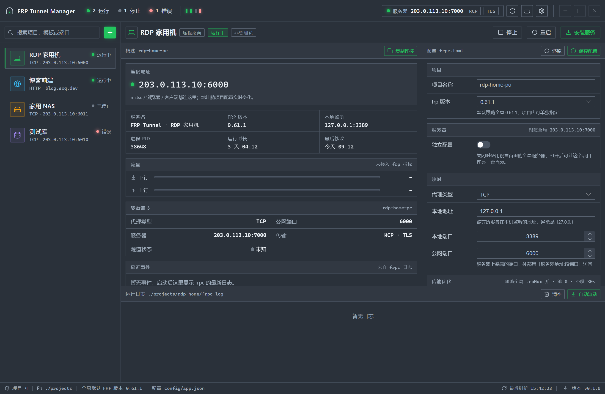
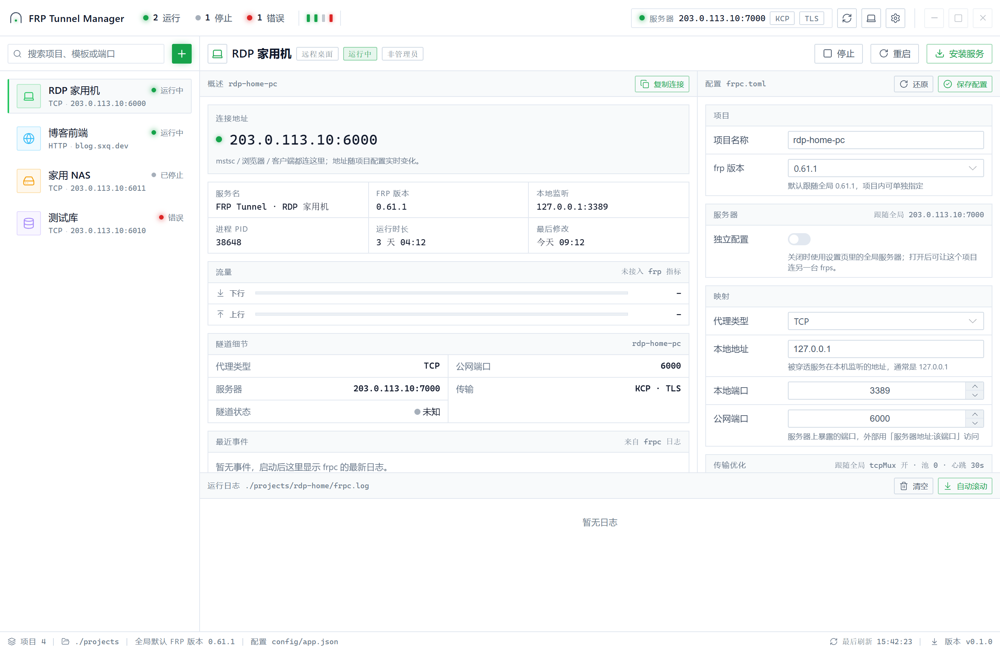
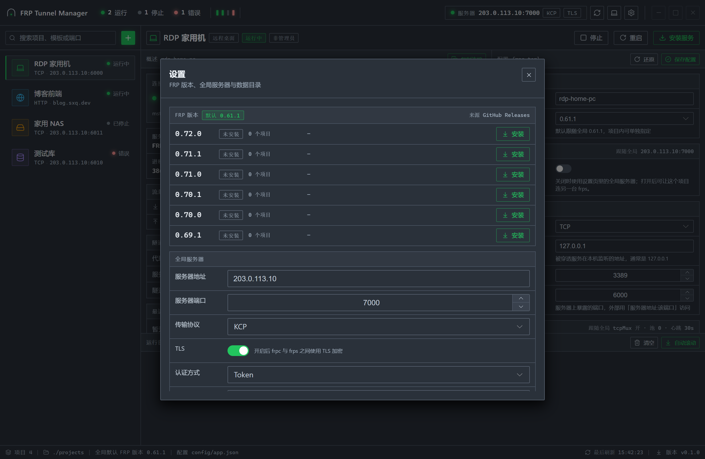
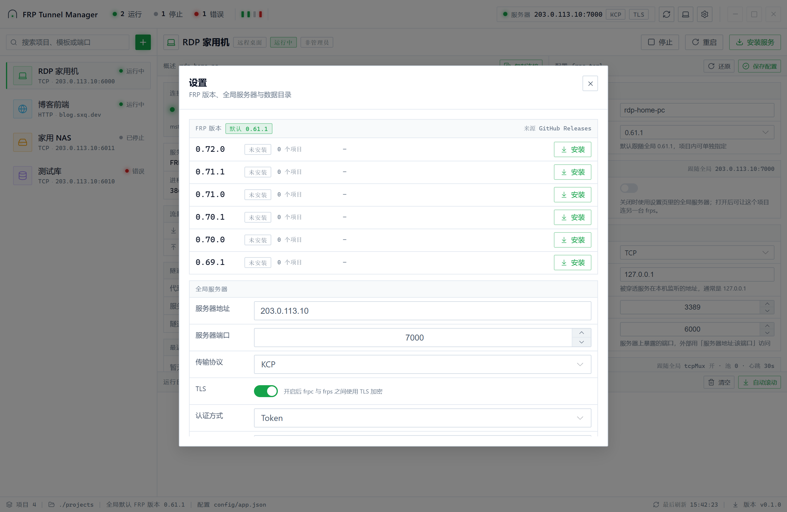

# FRP Tunnel Manager

把 [frp](https://github.com/fatedier/frp) 客户端收进一个图形界面的管理器：多项目隧道、模板化配置、服务托管、实时状态与日志。基于 Tauri 2 + Vue 3，Windows / macOS / Linux 通用，中文界面、便携运行。

## 功能

- **多项目管理** —— 每条隧道一个项目，配置、日志与运行状态互相独立。
- **开箱即用模板** —— RDP、Vite、SSH、HTTP、数据库、SMB、游戏联机、stcp、空白，自动生成带注释的 `frpc.toml`。
- **服务托管** —— Windows 服务（SCM）、macOS LaunchAgent、Linux systemd 用户单元，登录自启、崩溃自动拉起，不需要 nssm；macOS / Linux 免管理员权限。
- **frp 版本管理** —— 从 GitHub Releases 拉取真实版本列表，一键安装、切换、删除，镜像与代理可配。
- **真实状态与日志** —— 轮询 frpc 管理接口显示隧道连接状态，日志实时滚动，重启后可回看。
- **RDP 优化（仅 Windows）** —— 12 项远程桌面组策略一键开关，支持恢复未配置。
- **深色 / 浅色主题** —— 跟随系统，也可手动切换。

## 界面

| 深色 | 浅色 |
|---|---|
|  |  |
|  |  |

## 下载

到 [Releases](https://github.com/q310550690/FRP-Tunnel-Manager/releases) 下载对应平台：

| 平台 | 产物 |
|---|---|
| Windows | NSIS 安装包 / MSI |
| macOS | Universal DMG（Intel + Apple Silicon） |
| Linux | `.deb` / `.AppImage` |

便携运行：配置与日志写在程序所在目录（macOS 写在 `.app` 同级目录）。

## 快速开始

1. 打开程序，在 **设置 → FRP 版本** 里装一个 frpc 版本并设为全局默认。
2. 在 **设置 → 全局服务器** 填 frps 地址、端口、传输协议与 Token。
3. 点左侧 **+** 新建项目，选模板、改端口或域名。
4. 点 **启动** 直接运行，或点 **安装服务** 交给系统托管。

## 从源码构建

需要 Rust（Windows MSVC / macOS Xcode CLT / Linux gcc）、Node.js 20+ 与 pnpm：

```bash
pnpm install
pnpm tauri build
```

## 说明

- 仅支持 frp 0.52+（更早版本为 YAML 配置，不兼容）。
- Windows 安装服务与 RDP 组策略需要管理员权限；macOS LaunchAgent 与 Linux systemd 用户单元是用户级服务，不需要。
- 概览页流量暂显示 `—`：frpc 管理接口没有流量端点。
- 许可证：[AGPL-3.0](LICENSE)。
